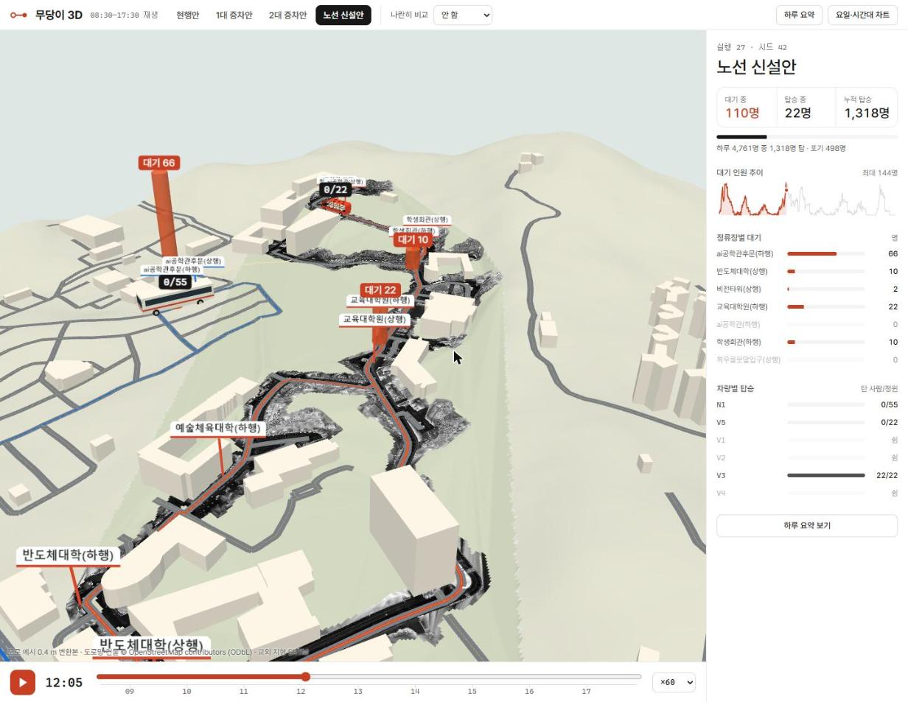
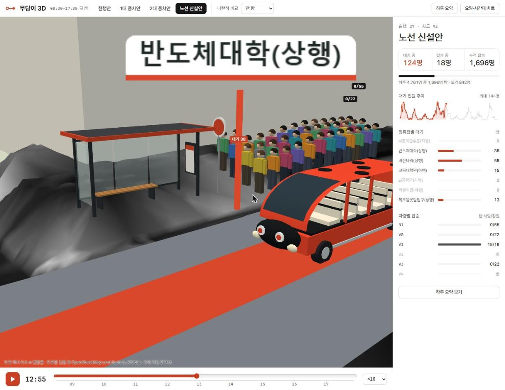
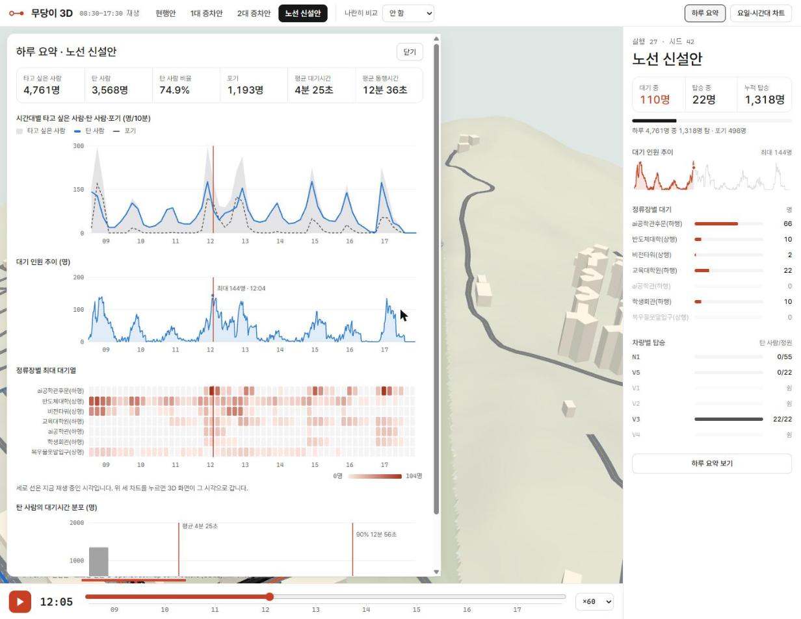
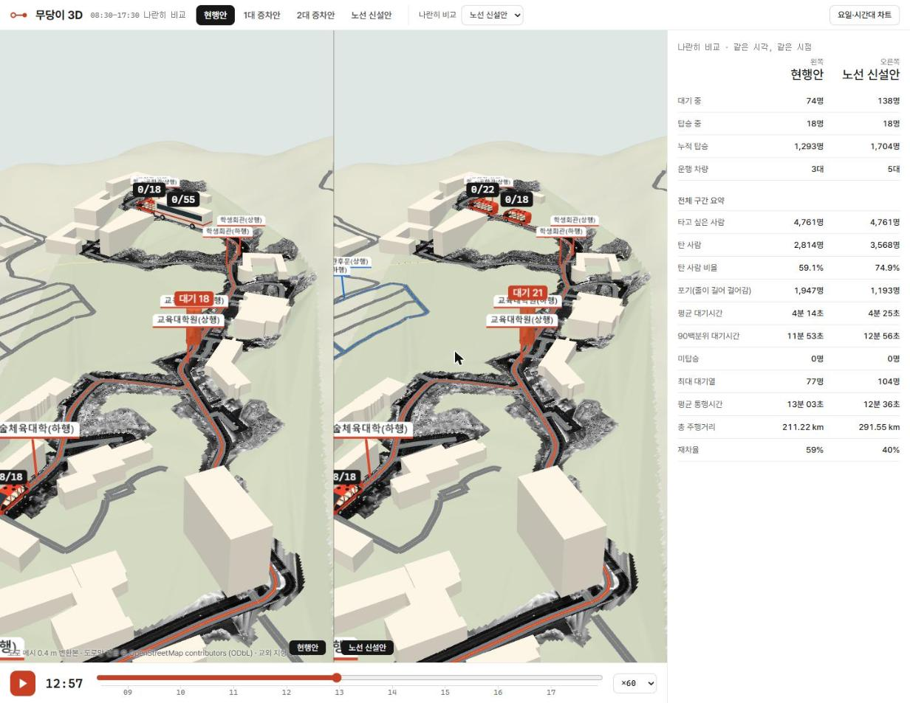

# 무당이 3D — 가천대학교 교내셔틀 운행 시뮬레이션

가천대학교 교내셔틀 '무당이'의 하루 운행을 교내 3차원 지형 위에서 재생하고, 운영 시나리오 네 가지의 결과를 같은 화면에서 비교하는 대시보드입니다.

**대시보드: <https://twtwtiwa05.github.io/mudang-sim/>**

[](https://twtwtiwa05.github.io/mudang-sim/?scenario=S3)

## 목차

- [개요](#개요)
- [화면 구성](#화면-구성)
- [시나리오](#시나리오)
- [주요 결과](#주요-결과)
- [자료와 방법](#자료와-방법)
- [가정과 한계](#가정과-한계)
- [사용 방법](#사용-방법)
- [저장소 구성](#저장소-구성)
- [자료 출처와 이용 조건](#자료-출처와-이용-조건)

## 개요

무당이는 반도체대학과 AI공학관 사이의 언덕길을 오가는 소형 셔틀입니다. 수업 시작 직전과 점심 전후에는 정류장에 줄이 길게 생기고, 일부 학생은 타지 못하고 걸어서 이동합니다.

이 프로젝트는 다음 두 가지를 다룹니다.

1. 실제 시간표와 차량 정원을 입력으로 현재 운행을 재현한다.
2. 차량을 늘리는 안과 노선을 새로 만드는 안을 같은 수요 조건에서 비교한다.

스마트 교통물류 과목의 기말 개인 프로젝트로 수행했습니다. 분석 대상은 평일 08:30~17:30이며, 화면에서 재생하는 운행일은 수요일입니다.

## 화면 구성

### 운행 재생

교내 지형과 건물 위에서 차량이 시간표대로 움직입니다. 차량 위의 숫자는 탑승 인원과 정원이고, 정류장의 주황색 기둥은 대기 인원입니다. 정류장에 가까이 가면 줄을 선 사람과 걸어오는 사람이 보입니다.



오른쪽 패널은 재생 시각에 따라 바뀌는 값을 보여 줍니다.

| 항목 | 내용 |
|---|---|
| 대기 중 | 그 시각에 모든 정류장에서 줄을 서 있는 사람 수 |
| 탑승 중 | 그 시각에 차량에 타고 있는 사람 수 |
| 누적 탑승 | 운행 시작부터 그 시각까지 탄 사람 수 |
| 정류장별 대기 | 정류장마다의 대기 인원 |
| 차량별 탑승 | 차량마다의 탑승 인원과 정원 |

### 하루 요약

상단의 '하루 요약'을 누르면 재생 중인 시나리오의 하루를 시간 순서로 볼 수 있습니다.



- 시간대별 타고 싶은 사람, 탄 사람, 포기한 사람 (10분 단위)
- 전체 정류장의 대기 인원 추이
- 정류장별·시간대별 최대 대기열
- 탄 사람의 대기시간 분포

시간 축이 있는 차트를 누르면 3차원 화면이 그 시각으로 이동합니다.

### 나란히 비교

'나란히 비교'에서 시나리오를 하나 더 고르면 화면이 좌우로 나뉘고, 두 시나리오가 같은 시각과 같은 시점으로 함께 재생됩니다.



'요일·시간대 차트'에서는 네 시나리오의 시간대별 탑승 인원과 요일별 탑승 비율을 함께 볼 수 있습니다.

## 시나리오

| 이름 | 내용 | 운행 차량 |
|---|---|---|
| 현행안 | 실제 노선과 시간표 그대로 | 소형 5대, 점심 대형 1대 |
| 1대 증차안 | 22인승 1대 추가. 배차간격(headway) 5분 → 4분 10초 | 소형 6대, 점심 대형 1대 |
| 2대 증차안 | 22인승 2대 추가. 배차간격 5분 → 약 3분 34초 | 소형 7대, 점심 대형 1대 |
| 노선 신설안 | 현행 노선 유지 + 신규 노선(비전타워 → 복우물웃말입구 → AI공학관 후문), 대형 버스 1대, 15분 간격 | 소형 5대, 대형 1대 |

노선 신설안의 대형 버스는 현행안에서 점심에 운행하던 차량을 신규 노선으로 옮긴 것입니다. 따라서 현행안과 비교해 추가되는 차량은 없습니다.

## 주요 결과

월~금 합계이며 기준 수요는 23,137명입니다. 난수 시드는 42로 고정했습니다.

| 지표 | 현행안 | 1대 증차안 | 2대 증차안 | 노선 신설안 |
|---|---:|---:|---:|---:|
| 탄 사람 (명) | 13,566 | 15,320 | 16,701 | 17,712 |
| 탄 사람 비율 (%) | 58.6 | 66.2 | 72.2 | 76.6 |
| 평균 통행시간 (분) | 12.9 | 12.4 | 11.8 | 12.8 |
| 총 주행거리 (km) | 1,056.1 | 1,275.6 | 1,494.7 | 1,457.8 |

수요일 하루의 상세 값은 다음과 같습니다. 타고 싶은 사람은 4,761명입니다.

| 지표 | 현행안 | 1대 증차안 | 2대 증차안 | 노선 신설안 |
|---|---:|---:|---:|---:|
| 탄 사람 (명) | 2,814 | 3,171 | 3,410 | 3,568 |
| 포기하고 걸어간 사람 (명) | 1,947 | 1,590 | 1,351 | 1,193 |
| 평균 대기시간 (분) | 4.2 | 3.5 | 2.7 | 4.4 |
| 90백분위 대기시간 (분) | 11.9 | 11.3 | 10.6 | 12.9 |
| 최대 대기열 (명) | 77 | 95 | 117 | 104 |
| 재차율(load factor, %) | 58.8 | 54.7 | 50.1 | 40.0 |

대기시간과 통행시간은 탄 사람만 대상으로 계산합니다. 줄이 길면 타지 않고 걸어가는 규칙을 두었으므로 대기시간은 일정 수준에서 잘립니다. 이 때문에 시나리오 사이의 차이는 대기시간보다 탄 사람 수와 포기한 사람 수에서 더 뚜렷하게 나타납니다.

## 자료와 방법

**운행 자료.** 차량에 부착된 시간표와 현장에서 잰 구간 운행시간으로 GTFS 형식의 시간표를 만들었습니다. 차량 정원은 소형 18명과 22명, 대형 55명입니다.

**수요.** 승객 수를 직접 센 자료가 충분하지 않아, 대학이 공개한 강의 시간표의 건물·교시·정원에서 수요를 추정했습니다. 수업 시작과 종료 시각에 맞춰 각 건물과 가까운 정류장에 승객이 나타나며, 정원 가운데 셔틀을 이용하려는 비율은 가정값입니다. 이 값을 '타고 싶은 사람', 즉 잠재 수요(latent demand)로 부릅니다.

**탑승과 포기.** 승객은 도착한 순서대로 줄을 서고, 차량은 정원까지만 태웁니다. 승객은 정류장에 도착한 시점에 예상되는 대기시간이 한도를 넘으면 줄을 서지 않고 걸어갑니다. 한도는 상행 15분, 하행 5분입니다. 중간 정류장에서는 만차로 두 번 지나치면 걸어갑니다.

**보정.** 현장에서 기록한 정류장 대기 인원 14건을 이용해 이용 비율과 대기 한도를 맞추었습니다. 이 기록은 모두 보정에 사용했으므로, 독립된 자료로 검증한 결과는 아닙니다.

**민감도.** 수요 수준을 낮음·기준·높음 세 가지로 바꾸어 같은 실험을 반복했습니다. 세 수준 모두에서 탄 사람 수의 순서는 위 표와 같았습니다.

## 가정과 한계

- 수요는 관측값이 아니라 강의 시간표에서 추정한 값이다. 이용 비율과 도착 시점의 분포는 가정이다.
- 구간 이동시간은 시간표 값으로 고정했다. 도로 혼잡과 운행 지연은 반영하지 않았다.
- 교내 도로의 폭과 경사 때문에 생기는 증차의 한계는 모형에 없다.
- 포기하고 걸어간 사람의 이동시간은 통행시간에 넣지 않았다.
- 신규 노선의 정류장 위치, 운행 속도(18 km/h), 정류장에서 건물까지 걷는 시간은 설계값과 가정값이다. 해당 구간에 실제로 차량이 다닐 수 있는지는 확인하지 못했다.
- 화면의 정류장 쉘터, 사람 모형, 종점에서의 차량 이동은 이해를 돕기 위한 표현이며 분석 값에 영향을 주지 않는다.

## 사용 방법

| 조작 | 방법 |
|---|---|
| 재생·정지 | 화면 아래의 재생 단추 |
| 시각 이동 | 시간 막대를 끌거나 차트를 누름 |
| 재생 속도 | 화면 아래 오른쪽의 배속(×5 ~ ×300) |
| 시점 | 끌어서 회전, 휠로 확대·축소 |
| 정류장 확대 | 정류장 표지나 '대기 N' 표를 누름. Esc를 누르면 이전 시점으로 돌아감 |
| 차량 따라가기 | 차량 위의 숫자를 누름 |

주소로 시나리오를 지정할 수 있습니다.

| 주소 | 화면 |
|---|---|
| [`?scenario=S0`](https://twtwtiwa05.github.io/mudang-sim/?scenario=S0) | 현행안 |
| [`?scenario=S1`](https://twtwtiwa05.github.io/mudang-sim/?scenario=S1) | 1대 증차안 |
| [`?scenario=S2`](https://twtwtiwa05.github.io/mudang-sim/?scenario=S2) | 2대 증차안 |
| [`?scenario=S3`](https://twtwtiwa05.github.io/mudang-sim/?scenario=S3) | 노선 신설안 |
| [`?scenario=S0&compare=S3`](https://twtwtiwa05.github.io/mudang-sim/?scenario=S0&compare=S3) | 현행안과 노선 신설안 나란히 비교 |

WebGL을 지원하는 데스크톱 브라우저에서 확인했습니다. 지형 자료를 내려받는 동안 몇 초가 걸릴 수 있습니다.

## 저장소 구성

이 저장소에는 대시보드를 실행하는 데 필요한 빌드 결과만 있습니다.

```
index.html        대시보드 진입점
assets/           화면 코드(빌드 결과)
results/          시나리오별 시뮬레이션 결과(S0~S3)와 요일·시간대별 집계
dev/              노선 선형, 정류장, 보행로, 도로, 건물
campus.glb        교내 지형 메시(변환본)
height*.bin       지형 높이 격자
docs/             이 문서의 그림
```

화면의 모든 수치는 `results/`의 결과 파일에서 읽어 계산합니다. 시뮬레이션 코드, 입력 자료, 재현 방법은 과제 제출물에 포함했습니다.

대시보드는 [three.js](https://threejs.org/)와 [Vite](https://vite.dev/)로 만들었습니다.

## 자료 출처와 이용 조건

| 자료 | 출처 |
|---|---|
| 도로망, 건물 외곽선 | © OpenStreetMap contributors, ODbL 1.0 |
| 교외 지형 | SRTM 표고 자료 |
| 교내 지형 | 제공받은 교내 측량 메시(0.4 m 격자)를 줄여 변환한 것 |
| 강의 시간표 | 가천대학교 강의 시간표 조회 화면 (2026-11-21 수집) |
| 운행 시간표, 차량 정원, 대기 인원 기록 | 현장 조사 |

교내 지형 자료는 제공자의 허락을 받아 변환본만 실었습니다. 이 자료를 다른 목적으로 다시 배포하지 마십시오.
